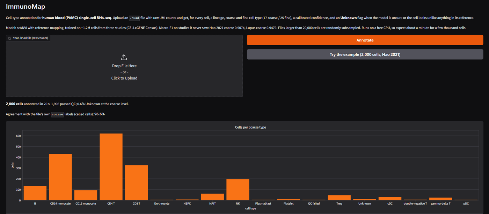

# ImmunoMap

**Immune cell-type annotation for human blood single-cell RNA-seq.** Upload a PBMC
`.h5ad` file and get, for every cell, a lineage, coarse and fine cell type, a calibrated
confidence, and an **Unknown** flag when the model is unsure or the cell looks unlike
anything it was trained on.

[](https://github.com/sachitsatyal/Immunomap/actions/workflows/ci.yml)
[](https://github.com/sachitsatyal/Immunomap/actions/workflows/deploy.yml)
[](https://huggingface.co/spaces/sawcheet/immunomap)
[](https://huggingface.co/sawcheet/immunomap-scanvi-v1)

**[Try the live demo →](https://huggingface.co/spaces/sawcheet/immunomap)**



## Results

Trained on ~775k cells from three studies (Sound Life, AIDA, OneK1K; CELLxGENE Census
`2025-11-08`). Test = held-out donors. Hao 2021 and Lupus = **studies never seen in
training**, scored one study at a time. Macro-F1:

| Model | Coarse test | Coarse Hao | Coarse Lupus | Fine test | Fine Hao |
|---|---|---|---|---|---|
| Logistic regression (baseline) | 0.945 | 0.898 | 0.886 | 0.904 | 0.827 |
| Geneformer V2-104M + LoRA | 0.953 | 0.894 | 0.925 | 0.933 | 0.828 |
| **scANVI + scArches (shipped)** | **0.966** | **0.907** | **0.948** | **0.948** | **0.855** |

- **Calibrated confidence:** temperature scaling on validation. At the fine level the
  shipped model labels **99.3% of cells at 95% accuracy** (the baseline needed to mark
  18% of cells Unknown for the same accuracy).
- **Unknown detection:** k-NN distance to the reference in scANVI's latent space flags
  ~1% of normal cells. With two cell types removed from training entirely, distance
  separates them from known cells with AUROC 0.98 (confidence alone: 0.54).
- **Why not the foundation model:** fine-tuned Geneformer beat the baseline on held-out
  donors and on Lupus, but only tied it on Hao and trailed scANVI everywhere, while being
  ~100× slower to serve (≈175 cells/s on an RTX 5090 vs. thousands for scANVI). scANVI
  is more accurate *and* cheaper, so it ships.

## How it works

1. **Data:** 1.25M blood cells from CELLxGENE Census; author labels mapped to a
   three-level Cell Ontology tree (6 lineages → 17 coarse → 25 fine types); donor-level
   train / val / test splits.
2. **QC:** per-donor adaptive thresholds (low-count, low-gene, high-mitochondrial cells).
3. **Features:** 3,002 genes (highly variable on training data + canonical markers).
4. **Model:** scVI → scANVI per label level, with the scArches architecture so a new
   dataset (e.g. an upload) is mapped onto the reference using only its expression.
5. **Outputs:** calibrated probabilities, an Unknown threshold, a novelty distance, and a
   check that the fine label agrees with the coarse label.

## Use it

**Online:** open the [demo](https://huggingface.co/spaces/sawcheet/immunomap), upload
an `.h5ad` with raw counts (in `X`, `layers["counts"]` or `.raw`; Ensembl IDs or gene
symbols), or click *Try the example*. Up to 10,000 cells; download all results as CSV.

**Locally** (Python 3.12, [uv](https://docs.astral.sh/uv/)):

```bash
git clone https://github.com/sachitsatyal/Immunomap && cd Immunomap
uv sync --group app

# web app (downloads the model bundle and example from Hugging Face on start)
IMMUNOMAP_HF_REPO=sawcheet/immunomap-scanvi-v1 uv run --group app python app.py

# command line
uv run hf download sawcheet/immunomap-scanvi-v1 --local-dir data/models/bundle/immunomap-scanvi-v1
uv run python scripts/annotate.py my_pbmc.h5ad annotations.csv
```

## Reproduce training

Requires a CUDA GPU; MLflow logs every run (`sqlite:///mlflow.db`).

```bash
uv run dvc repro                              # QC → gene selection → model inputs
uv run python scripts/train_baseline.py       # logistic-regression baseline
uv run python scripts/train_scanvi.py         # scVI + scANVI (coarse, fine)
uv run python scripts/calibrate_scanvi.py     # calibration, Unknown threshold, novelty
uv run python scripts/export_bundle.py        # package the model for deployment
```

The data download (`scripts/build_manifest.py`, `scripts/pull_expression.py`) uses the
CELLxGENE Census API. Geneformer: `scripts/tokenize_geneformer.py`,
`scripts/finetune_geneformer.py`.

## Engineering

- **Code quality:** ruff, strict mypy, pytest (unit tests run in CI; data tests run
  locally), pre-commit hooks.
- **CI/CD:** GitHub Actions runs lint, type-check and tests on every PR; after CI passes
  on `main`, the demo is redeployed to Hugging Face Spaces at that exact commit and the
  workflow waits until it is running.
- **Reproducibility:** DVC pipeline, pinned Census version, uv lockfile, MLflow runs
  tied to the git commit and data hash; the deployed model bundle carries a manifest.

```
src/immunomap/   data (QC, labels, features), models, evaluation, inference
scripts/         pipeline, training, evaluation, export and deployment
configs/         every setting (QC, labels, models, calibration)
app.py           Gradio demo · deploy/space/ Space config · tests/ unit and data tests
```

## Limitations

Human blood only (not tissues, not other species). A new cell type close to a known one
can be labelled as that type instead of Unknown (in the held-out test, 36% of
plasmablasts and 73% of HSPCs were flagged). Research use only, not for diagnosis.

## Acknowledgements

Data: [CELLxGENE Census](https://chanzuckerberg.github.io/cellxgene-census/) (CC BY 4.0),
including Hao et al. 2021. Models: [scvi-tools](https://scvi-tools.org) and
[Geneformer](https://huggingface.co/ctheodoris/Geneformer). License: see [LICENSE](LICENSE).
